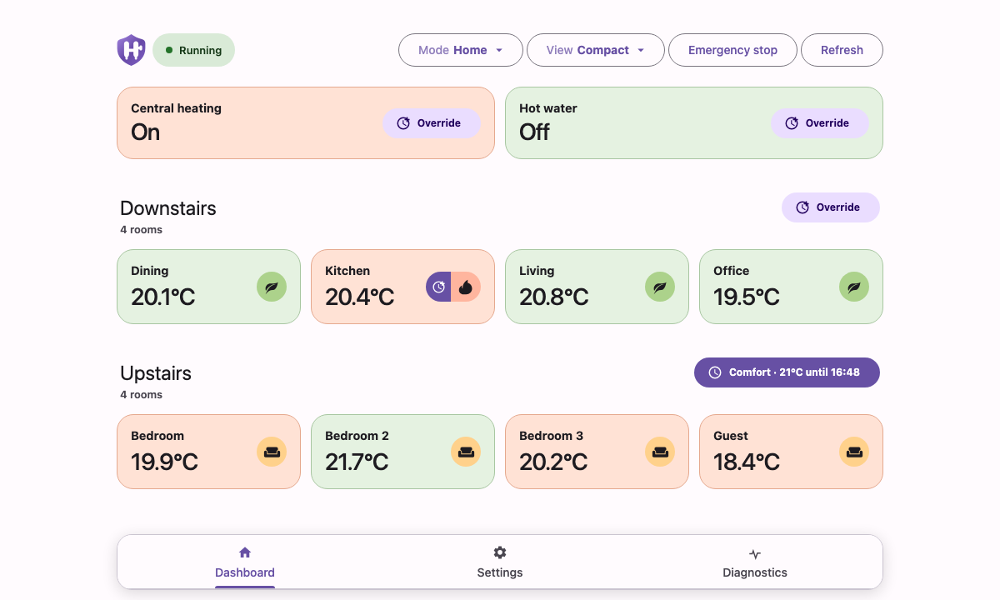

  

# Heat Steward

Heat Steward is a Home Assistant add-on for reliable room-by-room heating and
hot-water control. It brings schedules, temporary overrides, monitoring, and
diagnostics into one interface while leaving each radiator valve usable if the
add-on or Home Assistant is unavailable.

> [!IMPORTANT]
> Heat Steward is currently experimental. It can operate heating relays and
> radiator valves, so review the configuration and test it while someone is
> home before relying on it unattended.

## Designed for

- SONOFF TRVZB radiator valves exposed to Home Assistant
- Optional external room-temperature sensors
- Optional Home Assistant switch entities for central heating and hot water
- Home Assistant 2026.1 or newer with add-on support

Heat Steward's automatic device discovery is currently specialised for the
SONOFF TRVZB. Other radiator valves are not yet supported.

## Highlights

- Weekly schedules for room groups and hot water
- Home and Away modes, plus timed room, floor, whole-house, and hot-water overrides
- Independent room fault handling, temperature-sensor fallback, and command verification
- Compact everyday dashboard and detailed diagnostics
- Persistent 90-day control history ready for future charts and adaptive heating
- Optional Discord issue and recovery notifications
- Configuration and override state included in normal Home Assistant backups

## Getting started

Install and start the add-on, open its web interface, and follow the setup
wizard. The required steps select your radiator valves, configure any boiler
relays, and create room schedules. No YAML is required.

See the [full documentation](DOCS.md) for installation, setup, safety behaviour,
Home Assistant automations, backups, and troubleshooting. You can also read the
[project overview](https://github.com/oliver-johnston/heat-steward) or
[report an issue](https://github.com/oliver-johnston/heat-steward/issues).

Heat Steward is released under the [MIT License](../LICENSE).
